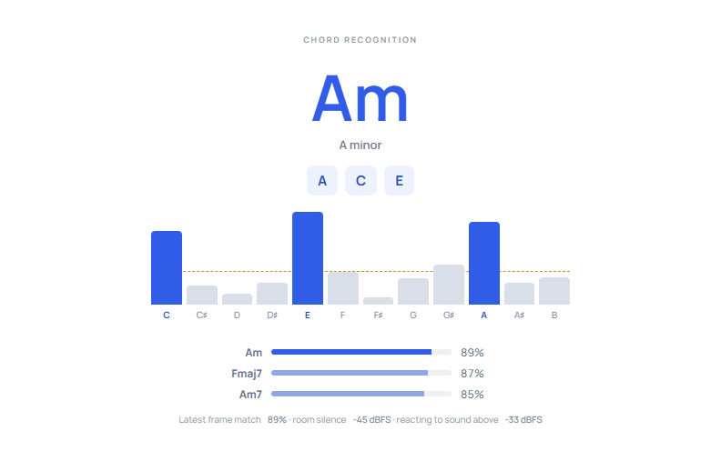
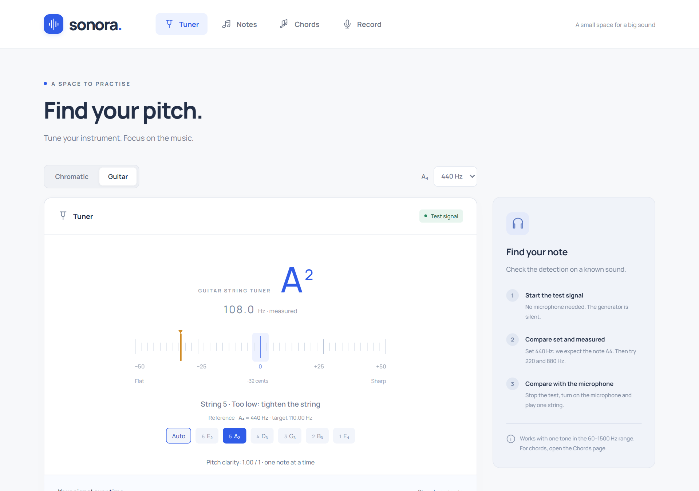
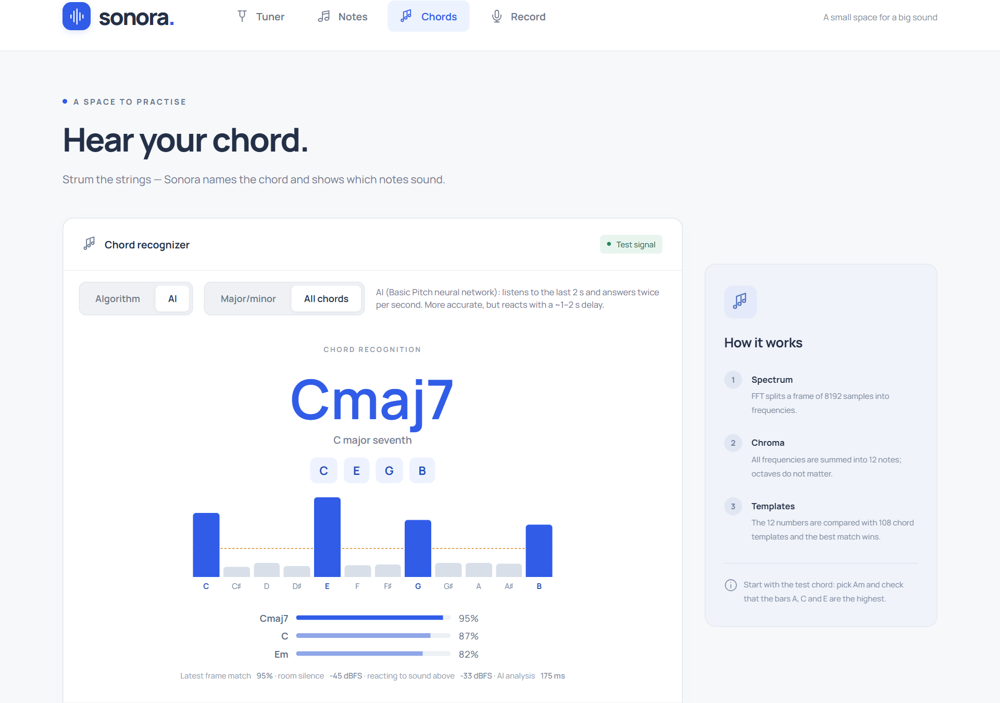
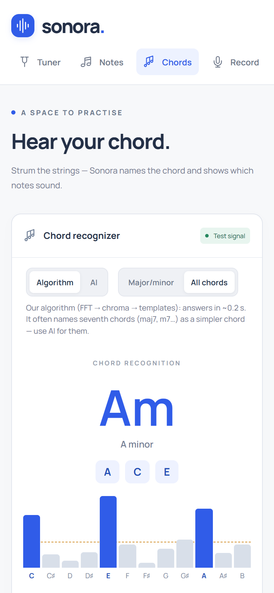

<div align="center">

# sonora.

**A guitar tuner and chord recognizer that runs entirely in your browser.**

Tune your strings, find a note, or strum a chord: Sonora names it and shows which notes it hears.
No server, no sign-up, and the sound never leaves your device.

### [▶ Try it live: sonora-one-wheat.vercel.app](https://sonora-one-wheat.vercel.app)



</div>

---

## Features

- **Tuner** — chromatic or guitar mode (standard tuning, auto or manual string), A₄ reference 432–442 Hz, a smooth needle in cents.
- **Note finder** — shows the note and octave on a piano keyboard.
- **Chord recognizer** — 108 chords: major, minor, 7, maj7, m7, dim, m7♭5, aug and power chords.
- **Two engines, one switch:**
  - **Algorithm** — our own FFT → chroma → chord templates pipeline. Answers in ~0.2 s.
  - **AI** — Spotify's [Basic Pitch](https://github.com/spotify/basic-pitch) neural network running locally with TensorFlow.js (WebGL). Slower (~1–2 s), but much better at seventh chords.
- **Stable display** — a level gate that learns your room's noise, stabilizers against flicker, and the last chord kept on screen while it fades.
- **Test signals** — a silent built-in generator (single tones and open guitar chords), so everything can be tried without a microphone.
- **Private by design** — all audio processing happens in the browser; nothing is recorded or uploaded.

## Screenshots

| Tuner (guitar mode) | AI recognizing Cmaj7 |
|---|---|
|  |  |

<p align="center">
  
</p>

## How it works

```
microphone ─▶ Web Audio ─┬─▶ Pitchy (McLeod) ───────────────▶ note + cents      (tuner)
                         │
                         ├─▶ FFT ─▶ 12-note chroma ─┐
                         │                          ├─▶ 108 chord templates ─▶ live tracker ─▶ chord
                         └─▶ Basic Pitch (AI) ──────┘      + tuned rules         (gate, hold)
```

Both chord engines produce the same 12-number "chroma" (how strongly each pitch class sounds),
so the chord decision is shared and the two can be compared fairly.

## Accuracy

Measured on [GuitarSet](https://zenodo.org/records/3371780) (real guitar recordings, CC BY 4.0) and on my own recordings:

| | Algorithm | AI (Basic Pitch) |
|---|---|---|
| GuitarSet, all chord types (762 chords) | 57 % | **78 %** |
| — major 7th / minor 7th / dominant 7th | 22 % / 16 % / 31 % | **69 % / 54 % / 51 %** |
| My own recordings, major/minor (51 takes) | 82 % | **90 %** |
| Time until a chord appears | ~0.2 s | ~1.5–2 s (one analysis ≈ 110 ms on WebGL) |

Settings were chosen on GuitarSet and only checked on the other sets.
Full reports: [`docs/results/`](docs/results).

## Run locally

Requires Node.js 22.18+ (Node 24 recommended).

```sh
npm install
npm run dev        # http://localhost:5173
```

The microphone needs `localhost` or HTTPS. The test signal works anywhere.

```sh
npm test           # unit tests
npm run build      # type check + production build into dist/
npm run preview    # serve the production build
```

### Evaluation scripts

| Command | What it does |
|---|---|
| `npm run eval` | Runs both engines over `tests/recordings/real` and writes a report |
| `npm run make:guitarset-ext` / `npm run eval:guitarset-ext` | Builds and evaluates the GuitarSet test set |
| `npm run tune:basic-pitch` | Tunes the AI's note threshold |
| `npm run tune:chord-rules` | Tunes when a seventh / power chord is accepted |
| `npm run replay:live` | Replays recordings through the live page logic (flicker, dropouts) |
| `npm run bench:basic-pitch` | Measures the AI's speed |

Recordings are not part of the repository (GuitarSet is ~2 GB). See [`tests/recordings/README.md`](tests/recordings/README.md).

## Project structure

```
src/audio/        signal processing: FFT, chroma, templates, level gate, engines
src/hooks/        connects audio to React
src/components/   UI pieces;  src/views/  pages
public/models/    the Basic Pitch model (loaded only when AI is turned on)
scripts/          evaluation and tuning tools
tests/            unit tests (node --test)
docs/             notes and results (in Ukrainian)
```

## Tech

React 19 · TypeScript · Vite · Web Audio API (AudioWorklet) · [Pitchy](https://github.com/ianprime0509/pitchy) · TensorFlow.js · [Basic Pitch](https://github.com/spotify/basic-pitch)

## Credits

- **Basic Pitch** by Spotify — Apache License 2.0 (model files in `public/models/basic-pitch`, with its license).
- **GuitarSet** — Q. Xi, R. Bittner, J. Pauwels, X. Ye, J. P. Bello, *GuitarSet: A Dataset for Guitar Transcription*, ISMIR 2018. CC BY 4.0.
- **Pitchy** — MIT.

Sonora is my bachelor's thesis project.
