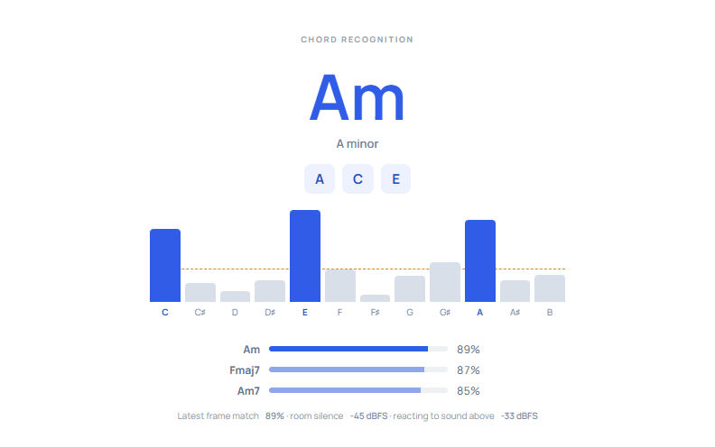
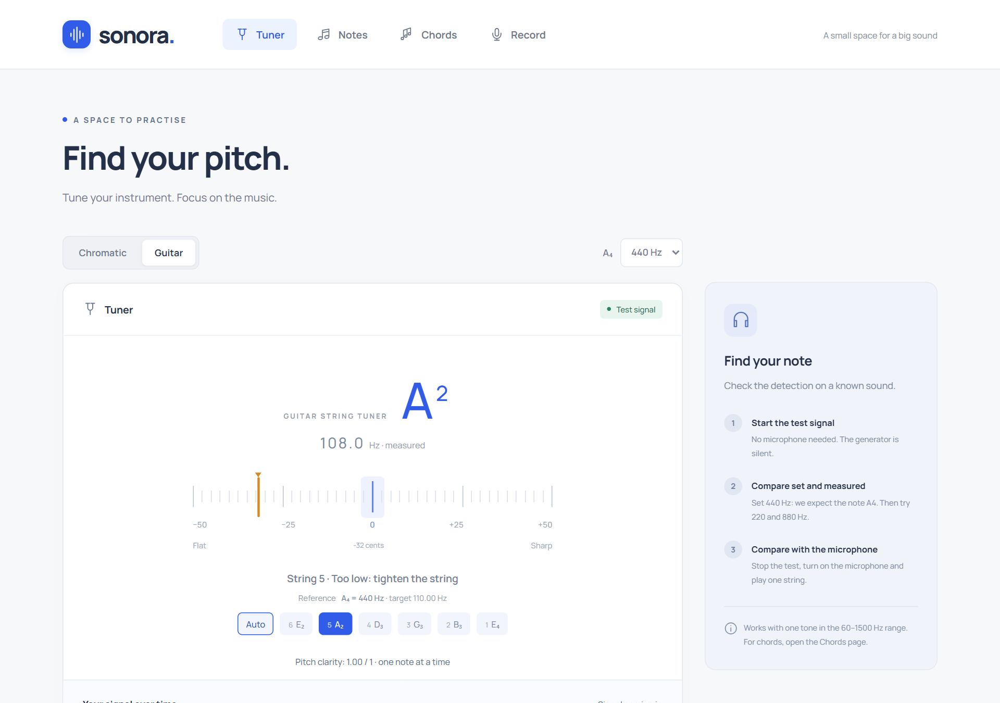
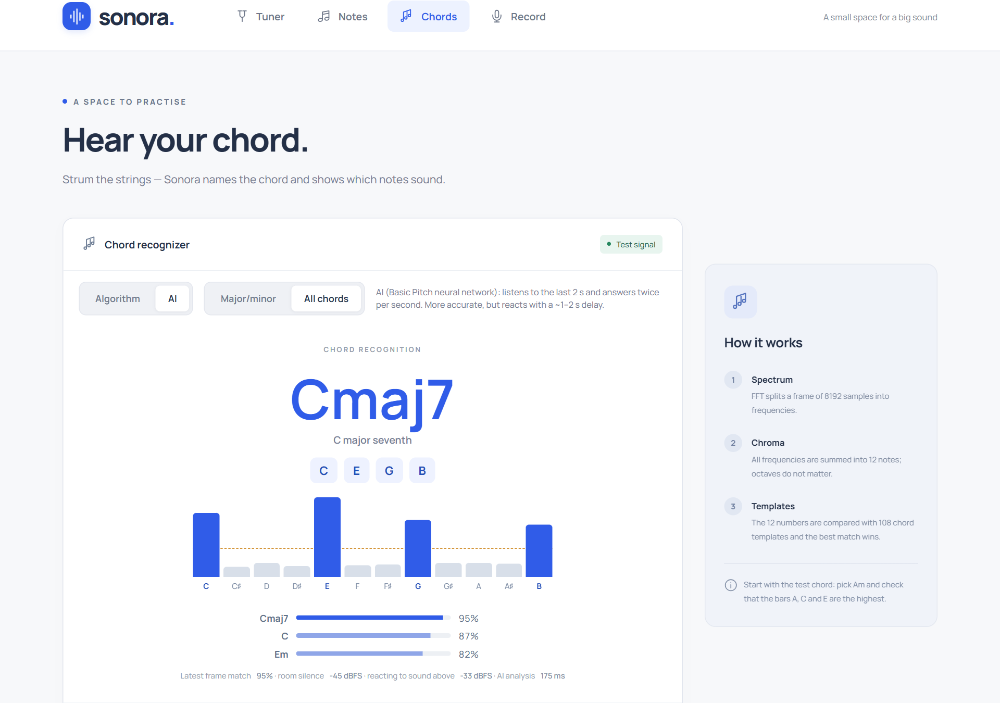
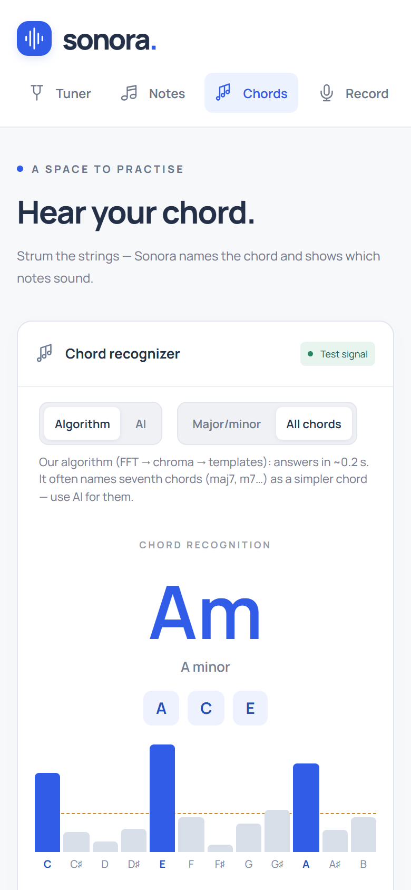

<div align="center">

# sonora.

**A guitar tuner and chord recognizer that runs entirely in your browser.**

Tune your strings, find a note, or strum a chord: Sonora names it and shows which notes it hears.
No server, no sign-up, and the sound never leaves your device.

### [▶ Try it live: sonora-one-wheat.vercel.app](https://sonora-one-wheat.vercel.app)



</div>

---

## Features

- **Tuner** — YIN pitch detection, chromatic or guitar mode (standard tuning, auto or manual string), A₄ reference 432–442 Hz, a smooth needle in cents. Frames come from an AnalyserNode or an AudioWorklet (switchable, with live frame-to-screen latency; see `docs/results/latency-2026-11-18.md`).
- **Note finder** — shows the note and octave on a piano keyboard.
- **Chord recognizer** — 108 chords: major, minor, 7, maj7, m7, dim, m7♭5, aug and power chords.
- **Two engines, one switch:**
  - **Algorithm** — our own FFT → chroma → chord templates pipeline. Answers in ~0.2 s.
  - **AI** — Spotify's [Basic Pitch](https://github.com/spotify/basic-pitch) neural network running locally with TensorFlow.js (WebGL). Slower (~1–2 s), but much better at seventh chords.
- **Stable display** — a level gate that learns your room's noise, stabilizers against flicker, and the last chord kept on screen while it fades.
- **Test signals** — a silent built-in generator (single tones and open guitar chords), so everything can be tried without a microphone.
- **Private by design** — all audio processing happens in the browser; nothing is recorded or uploaded.

## Screenshots

| Tuner (guitar mode) | AI recognizing Cmaj7 |
|---|---|
|  |  |

<p align="center">
  
</p>

## How it works

```
microphone ─▶ Web Audio ─┬─▶ YIN ───────────────────────────▶ note + cents      (tuner)
                         │
                         ├─▶ FFT ─▶ 12-note chroma ─┐
                         │                          ├─▶ 108 chord templates ─▶ live tracker ─▶ chord
                         └─▶ Basic Pitch (AI) ──────┘      + tuned rules         (gate, hold)
```

Both chord engines produce the same 12-number "chroma" (how strongly each pitch class sounds),
so the chord decision is shared and the two can be compared fairly.

## Accuracy

Independent test on [GuitarSet](https://zenodo.org/records/3371780) (real guitar recordings, CC BY 4.0).
The data are split **by player before segmenting**: thresholds were chosen only on players 00–03 (dev),
frozen in [`scripts/chord-eval.config.json`](scripts/chord-eval.config.json), and then run **once** on players 04–05 (test).
Commit `044bb4d`, Basic Pitch 1.0.1; full report: [`docs/results/eval-test-2026-11-18.md`](docs/results/eval-test-2026-11-18.md).

| GuitarSet test (players 04–05) | vocabulary | Algorithm (DSP) | AI (Basic Pitch) |
|---|---|---|---|
| file correct ¹ | basic (24 major/minor), 236 files | 60.2 % | 64.0 % |
| file correct ¹ | extended (108 chords), 245 files | 49.0 % | **76.7 %** |
| windows correct | basic | 24.8 % | 64.0 % |
| windows with an answer | basic | 32.8 % | 71.2 % |
| windows with a wrong chord | basic | 8.0 % | 7.2 % |

¹ *file correct* = the most frequent chord **among the windows with an answer** is the played chord; windows without an answer are not counted.
Windows: first 0.3 s skipped, DSP window 8192 samples, AI window ≈ 2 s. Per-class counts and accuracy are in the report.

Extra check on 51 own recordings (same frozen configuration, not used for tuning): DSP 82.4 % files correct, AI 94.1 % (basic) / 92.2 % (extended).

Speed (synthetic test chord, Chromium 156 / Firefox 160 on a Windows laptop, median of 5): DSP shows a new chord after ~0.3 s; AI after ~2–4 s.
Earlier numbers in this README (57 % / 78 %) were measured on the same data the settings were tuned on and are no longer used.

## Run locally

Requires Node.js 22.18+ (Node 24 recommended).

```sh
npm install
npm run dev        # http://localhost:5173
```

The microphone needs `localhost` or HTTPS. The test signal works anywhere.

### Optional account (backend)

Sonora works without an account. Signing in keeps the settings on the server and records practice statistics (minutes, notes in tune, chords; never audio). The API is Node.js + Express in [`server/`](server/) with a libSQL (SQLite-compatible) database: a local file in development, [Turso](https://turso.tech) in production.

```sh
npm run server     # API on http://localhost:3001 (database file server/data/sonora.db)
npm run dev        # the dev server forwards /api to it
```

| Endpoint | |
|---|---|
| `POST /api/auth/register`, `/login`, `/logout` · `GET /api/me` | email + password (scrypt), session cookie (httpOnly, SameSite=Lax) |
| `GET` / `PUT /api/settings` | the same settings as in the browser, validated with `parseSettings` |
| `POST /api/stats/sessions` · `GET /api/stats/summary?days=7` | practice sessions and their summary |

Deployment: the API is one Vercel Function in the same project as the site ([`api/index.ts`](api/index.ts), [`vercel.json`](vercel.json)), so `/api` is on the same domain and the cookie is first-party. It needs `TURSO_DATABASE_URL` and `TURSO_AUTH_TOKEN`; step by step: [`docs/BACKEND-DEPLOY.md`](docs/BACKEND-DEPLOY.md).

```sh
npm test           # unit tests
npm run build      # type check + production build into dist/
npm run preview    # serve the production build
```

### Evaluation scripts

| Command | What it does |
|---|---|
| `npm run eval` | Runs both engines over `tests/recordings/real` and writes a report |
| `npm run make:guitarset-ext` / `npm run eval:guitarset-ext` | Builds and evaluates the GuitarSet test set |
| `npm run tune:dev` | Tunes the chord thresholds on the dev part of GuitarSet (players 00–03) |
| `npm run eval:test` | One run on the test part (players 04–05) with the frozen config |
| `npm run replay:live` | Replays recordings through the live page logic (flicker, dropouts) |
| `npm run bench:basic-pitch` | Measures the AI's speed |
| `npm run measure:tuner` | Tuner error in cents on test tones and guitar strings |

Recordings are not part of the repository (GuitarSet is ~2 GB). See [`tests/recordings/README.md`](tests/recordings/README.md).

## Project structure

```
src/audio/        signal processing: FFT, chroma, templates, level gate, engines
src/hooks/        connects audio to React
src/components/   UI pieces;  src/views/  pages
src/account/      sign-in state and settings sync;  src/stats/  practice statistics
server/           the API (Express + libSQL);  api/  its Vercel Function entry
public/models/    the Basic Pitch model (loaded only when AI is turned on)
scripts/          evaluation and tuning tools
tests/            unit tests (node --test)
docs/             notes and results (in Ukrainian)
```

## Tech

React 19 · TypeScript · Vite · Node.js + Express + libSQL/Turso · Web Audio API (AudioWorklet) · YIN pitch detection · TensorFlow.js · [Basic Pitch](https://github.com/spotify/basic-pitch)

## Credits

- **Basic Pitch** by Spotify — Apache License 2.0 (model files in `public/models/basic-pitch`, with its license).
- **GuitarSet** — Q. Xi, R. Bittner, J. Pauwels, X. Ye, J. P. Bello, *GuitarSet: A Dataset for Guitar Transcription*, ISMIR 2018. CC BY 4.0.
- **YIN** — A. de Cheveigné, H. Kawahara, *YIN, a fundamental frequency estimator for speech and music*, JASA 111(4), 2002. Our own implementation in `src/audio/yin.ts`.

Sonora is my bachelor's thesis project.
