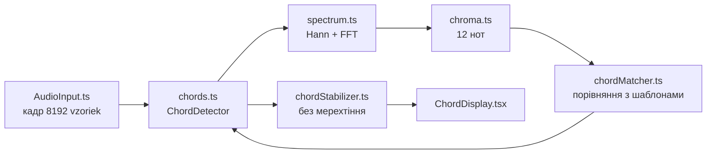

# Розпізнавач акордів: архітектура

Версія 1 (5 листопада 2026). Розпізнає **24 акорди**: 12 мажорних і 12 мінорних. Код написано так, щоб його було легко читати, а не щоб він був максимально швидким.

## 1. Рух даних

Один кадр проходить ось такий шлях:

1. **AudioInput** віддає 8192 vzorky (≈ 170 мс при 48 kHz).
2. **ChordDetector** перевіряє вхід, віднімає priemer (jednosmerná zložka) і відкидає тихі кадри (< −58 dBFS → `quiet`).
3. **spectrum.ts** множить кадр на Hannovo okno і робить FFT, на виході сила кожного кошика. **noiseFloor.ts** віднімає «підлогу шуму»: для кожної частоти медіану сусідів, тож шум кімнати не піднімає всі 12 нот.
4. **chroma.ts** складає силу всіх кошиків від 70 Hz до 2 kHz у 12 нот, без урахування октави, і масштабує так, щоб найсильніша нота дорівнювала 1.
5. **chordMatcher.ts** порівнює ці 12 чисел з 24 шаблонами («множимо й додаємо», cosine similarity) і сортує.
6. **ChordDetector** приймає найкращий акорд, лише якщо схожість ≥ 0.75 **і** кожна нота акорду ≥ 0.3. Інакше результат `unclear`.
7. **ChordStabilizer** змінює показаний акорд після 2 однакових кадрів поспіль. Показаний акорд тримається, поки він лишається найкращим кандидатом зі схожістю ≥ 0.6 (гістерезис), і зникає після 5 кадрів без нього.

## 2. Файли

| Шар | Файл | Що робить |
|---|---|---|
| Математика | `src/audio/fft.ts` | Рекурсивна FFT: парні/непарні → метелики. Перевірена проти DFT «в лоб» |
| | `src/audio/spectrum.ts` | Вікно Ганна + FFT → сила кожної частоти |
| | `src/audio/noiseFloor.ts` | Віднімає підлогу шуму (медіана сусідніх кошиків) |
| | `src/audio/chroma.ts` | Spektrum → 12 нот |
| | `src/audio/chordTemplates.ts` | 24 шаблони: корінь + інтервали (мажор 0-4-7, мінор 0-3-7) |
| | `src/audio/chordMatcher.ts` | Схожість chroma з шаблоном, рейтинг |
| | `src/audio/chords.ts` | `ChordDetector`: весь конвеєр + пороги + тип `ChordReading` |
| | `src/audio/chordStabilizer.ts` | Згладжування в часі |
| | `src/audio/demoChords.ts` | Відкриті акорди гітари для тестового сигналу й тестів |
| Аудіо | `src/audio/AudioInput.ts` | **Змінено:** розмір кадру задається; демо може грати кілька тонів |
| React | `src/hooks/useChordDetection.ts` | Раз на 100 мс: кадр → детектор → стабілізатор |
| | `src/hooks/useAudioInput.ts` | **Змінено:** параметр `frameSize`, функція `setDemoTones` |
| Інтерфейс | `src/components/ChordWorkspace.tsx` | Робоча область сторінки «Акорди» |
| | `src/components/ChordDisplay.tsx` | Акорд, ноти, 12 стовпчиків chroma, кандидати |
| | `src/components/AudioSourceControls.tsx` | **Винесено** з AudioWorkspace: кнопки джерела |
| | `src/components/AudioStatusBadge.tsx` | **Винесено** з AudioWorkspace: значок стану |
| | `src/views/ChordsView.jsx` | Сторінка `/#/chords` |
| Тести | `tests/fft.test.ts`, `tests/chords.test.ts` | FFT = DFT; 8 акордів при 44.1/48 kHz; одна нота ≠ акорд; тиша; стабілізатор |

Принцип той самий, що в тюнері: **хуки керують часом і станом React, а файли `audio/*` роблять математику.** Усе в `audio/*` можна тестувати в Node без браузера.

## 3. Пороги і чому саме такі

| Параметр | Значення | Чому |
|---|---|---|
| `CHORD_FRAME_SIZE` | 8192 | Кошик 5.9 Hz: басові ноти не зливаються з сусідами. 2048 (тюнер) дає 23 Hz, і це замало |
| `MIN_CHORD_DBFS` | −58 | Мікрофон ноутбука часто чує звичайний удар на −40…−50 dBFS. Шум відсікає крок noiseFloor |
| `MIN_CHORD_SCORE` | 0.75 | Виміряно на гітароподібних сигналах із шумом кімнати: 0.8 пропускав тихі акорди, 0.7 почав давати хибні |
| `MIN_TONE_LEVEL` | 0.3 | Одна струна через обертони «підсвічує» квінту, але терцію слабо. Без цього порогу нота A схожа на акорд A |
| `CHROMA_MIN/MAX_HZ` | 70–2000 | Нижче гул, вище здебільшого шум і далекі гармоніки |
| Стабілізатор | 2 / 5 кадрів, утримання від 0.6 | Новий акорд ≈ 0.2 с; не зникає, поки струни дзвенять |

Ці значення підібрано на **синтетичних** сигналах. Наступний крок — перевірити й підкрутити їх на записах справжньої гітари (див. ROADMAP, блок 6: confusion matrix).

## 4. Відомі обмеження версії 1

- Лише мажор і мінор. Септакорди (Am7, G7), sus, power-chords (E5) не розпізнаються.
- Інверсії розпізнаються як той самий акорд: chroma не знає, яка нота в басу.
- Схожі акорди (Am ↔ C, Em ↔ G) мають дві спільні ноти, тому на справжній гітарі можливі плутанини. Видно це в списку кандидатів.
- Удар медіатора дає шум у перших мілісекундах. Стабілізатор це згладжує, але не усуває.
- FFT навмисно написана просто, ≈ 6 мс на кадр. Якщо знадобиться швидше, її можна замінити на ітеративну версію без зміни інтерфейсу.
