# Sonora: карта проєкту й кожного вихідного файлу

Перевірено за поточним кодом: **17 жовтня 2026 року**. Карта охоплює **21 файл у `src`**, три тестові файли, конфігурацію, документацію та власні ресурси. Вміст установлених бібліотек `node_modules` і згенерованої збірки `dist` окремо не розбираємо.

**Почни з розділів 1–3.** Решта — довідник: відкривай лише той файл, який розбираємо зараз. У кожного файлу є посилання на код, його задача й окрема невелика схема.

## 1. Що ми будуємо і що вже є

Ти натискаєш Start і граєш струну. Застосунок отримує звук, визначає частоту й показує найближчу ноту та відхилення від неї. Замість мікрофона можна вибрати беззвучний тестовий генератор із відомою частотою.

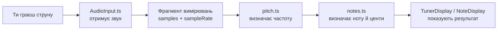

Це **спрощений рух даних**, а не список імпортів чи точна схема всіх викликів. Реальні аудіоз’єднання та два незалежні читачі вимірювань показані нижче.

Поточна версія працює з **одним тоном**, локально у браузері. Розпізнавання акордів, backend, профілів, бази даних і збереження налаштувань між перезавантаженнями ще немає. Мікрофонні дані не відправляються на сервер. Шрифт завантажується з Google Fonts.

## 2. Як читати різні схеми

| Назва схеми | Що означає стрілка |
| --- | --- |
| Склад інтерфейсу | Батьківський React-компонент показує дочірній |
| Аудіограф | Звук надходить з одного аудіовузла в інший через `connect()` |
| Рух даних | Результат або вимірювання передаються наступному обчисленню |
| Керування | Виклик методу, зміна стану або перевірка умови |
| Імпорти | Файл зліва імпортує файл справа; це не порядок виконання |

**Вузол / node** — аудіооб’єкт із певною задачею, наприклад аналізатор чи регулятор рівня. **Хук / hook** — функція React, яка поєднує стан і поведінку. **Callback** — передана функція, яку інший код викличе згодом.

## 3. Склад інтерфейсу

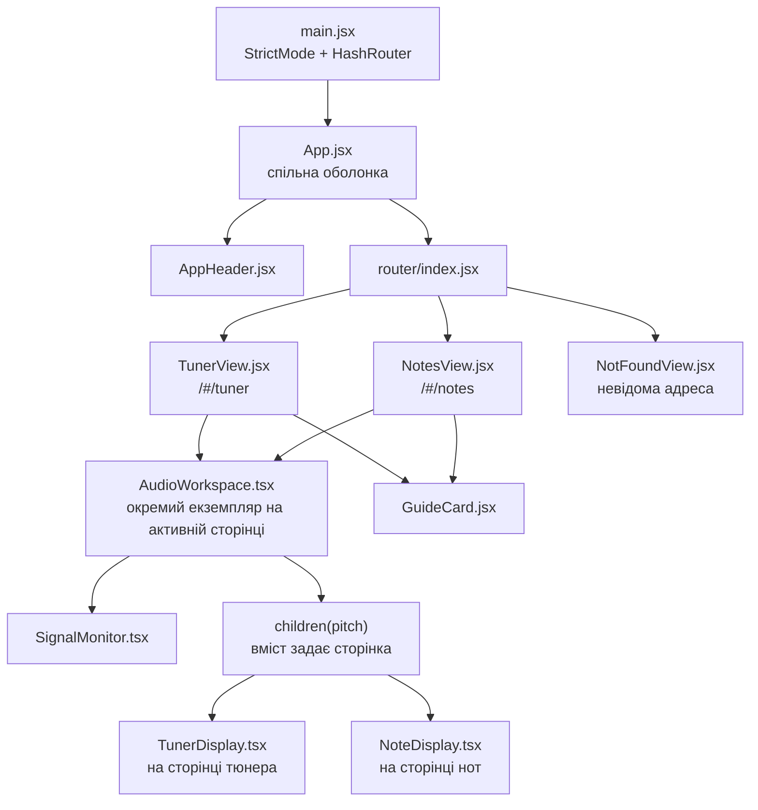

У схемі одна назва `AudioWorkspace`, але на маршрутах немає двох одночасно активних робочих областей. При переході між сторінками попередня розмонтовується; її аудіоресурси прибираються. `PageHeading` задає заголовки сторінок, а `AppIcon` — SVG-іконки; їх не повторюємо у великій схемі, щоб вона залишалась читабельною.

## 4. Реальний маршрут звуку та маршрут чисел

### 4.1 Аудіограф: куди надходить звук

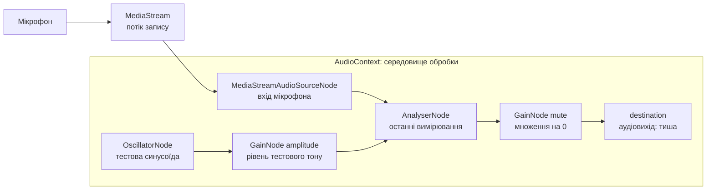

**Мікрофон і генератор — альтернативи:** в одній сесії працює одна гілка. `context` — контейнер, а не додатковий етап, через який окремо проходить звук. `mute` заглушує вихід після аналізатора; вимірювання перед ним залишаються доступними. Доступ до мікрофона сам по собі не вмикає відтворення в динаміках.

### 4.2 Читання вимірювань: два незалежні споживачі

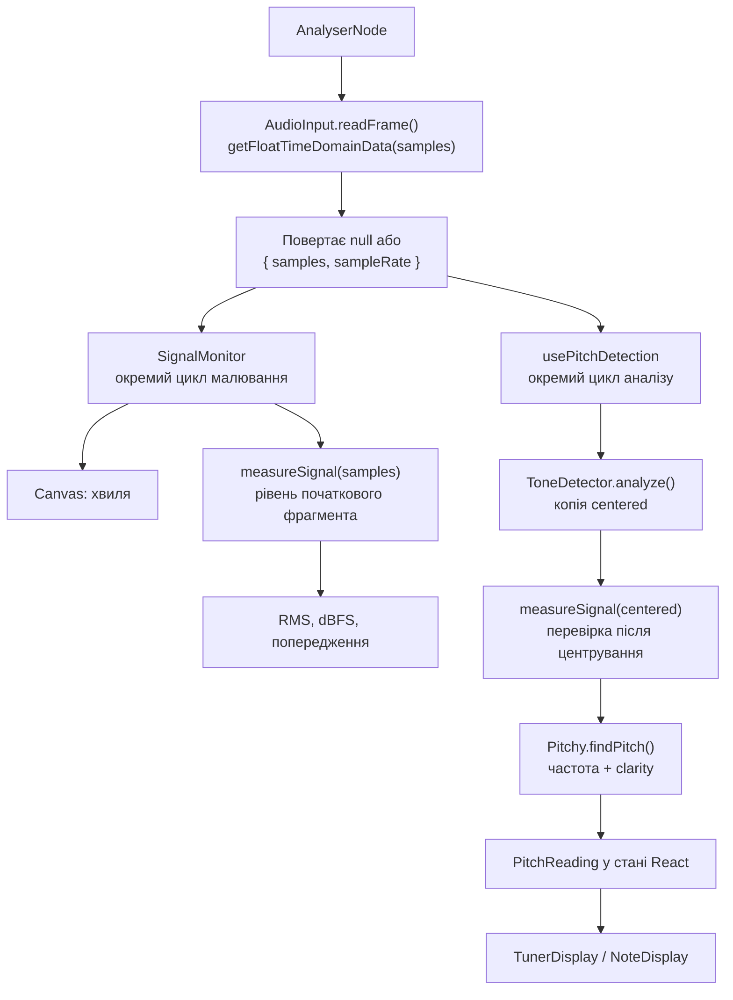

Кожен споживач **сам викликає `readFrame()`**. `SignalMonitor` не передає результат малювання в Pitchy. Обидва використовують один багаторазовий масив `session.samples`, який перезаписується при читанні; це свіжий знімок, а не накопичення запису. Обробка виконується синхронно в межах відповідного виклику. `ToneDetector` записує підготовлені значення у свій `centered`, не змінюючи вихідний масив.

Хвиля оновлюється через `requestAnimationFrame`; її числові показники — не частіше ніж раз на 100 мс. Аналіз частоти має власний цикл із перевіркою інтервалу щонайменше 75 мс. Частота оновлень інтерфейсу **не дорівнює `sampleRate`**: одна стосується кадрів інтерфейсу, інша — вимірювань звуку за секунду.

### 4.3 Які дані переходять між файлами

Усі наведені числа — ілюстрація форми результату, не вимірювання твого пристрою.

```ts
// AudioInput.readFrame(): one reusable snapshot, or null.
const frame = {
  samples: new Float32Array([0, 0.1, 0, -0.1]),
  sampleRate: 48000,
};

// ToneDetector.analyze(): accepted estimate, or a non-detected status.
const pitch = { status: "detected", frequency: 440, clarity: 0.98 };

// frequencyToNote(): musical interpretation, or null for invalid input.
const note = {
  midi: 69,
  pitchClass: 9,
  octave: 4,
  name: "A",
  fullName: "Ля",
  label: "A4",
  targetFrequency: 440,
  cents: 0,
  direction: "in-tune",
};
```

Чотири елементи в прикладі `frame` лише показують структуру. Робочий `AudioInput` використовує **2048** вимірювань. Число 440 у демоповзунку — налаштування генератора; показані виміряні Hz приходять через справжній аналіз масиву.

## 5. Від Start до Stop: порядок викликів

### Успішний запуск мікрофона

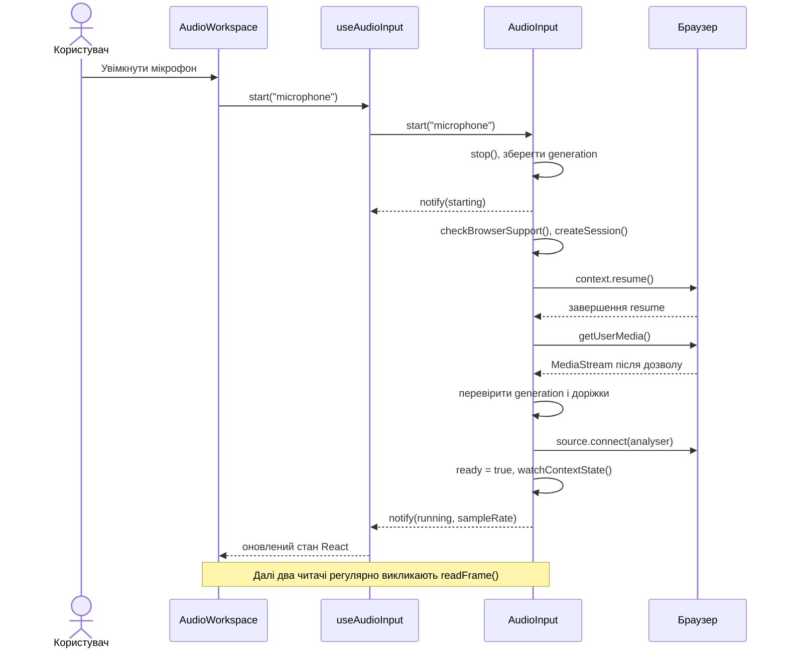

### Скасування під час очікування дозволу

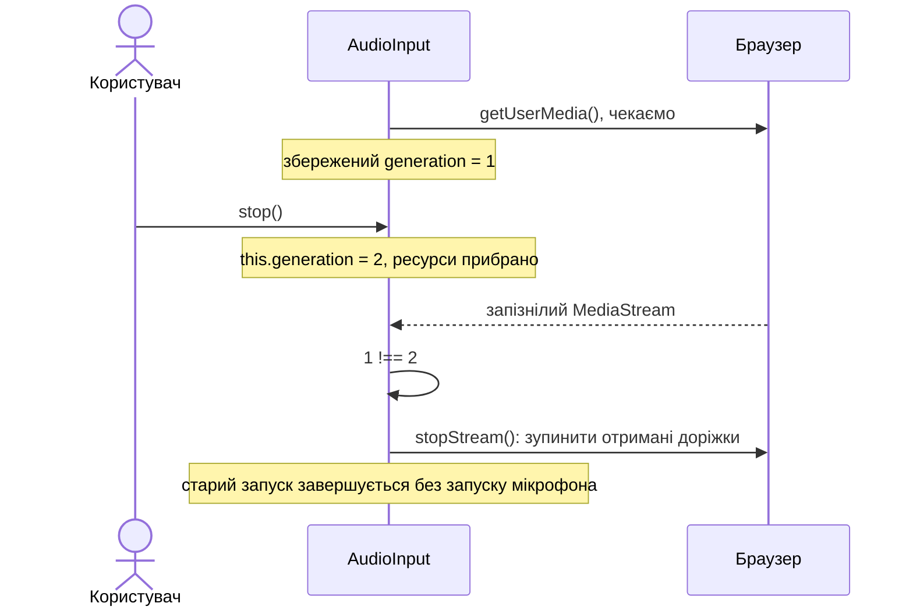

Числа поколінь умовні. Важлива **нерівність збереженого й актуального номера**, а не конкретні значення. `session` зберігає ресурси; `generation` перевіряє актуальність запуску; `notify` повідомляє React. Вони виконують різні задачі й самі не визначають частоту.

## 6. Файли запуску та маршрути

### `src/main.jsx`

[Відкрити main.jsx](C:/Users/theva/Documents/Codex/2026-10-08/hudobn-ci-asto-vyu-vaj-softv/outputs/sonora/src/main.jsx)

**Задача:** запустити React у HTML-елементі `#app`, підключити стилі й маршрутизатор. **Вхід:** DOM сторінки. **Результат:** змонтований `App`.

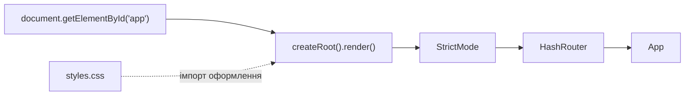

`HashRouter` читає адресу після `#`, наприклад `/#/tuner`. `StrictMode` допомагає виявляти проблеми під час розробки, зокрема з очищенням ефектів.

### `src/App.jsx`

[Відкрити App.jsx](C:/Users/theva/Documents/Codex/2026-10-08/hudobn-ci-asto-vyu-vaj-softv/outputs/sonora/src/App.jsx)

**Задача:** спільна оболонка сторінок і навігація клавіатурою. **Вхід:** `pathname` із маршрутизатора. **Результат:** шапка, основний вміст і футер; оновлені заголовок вкладки, фокус та прокрутка.

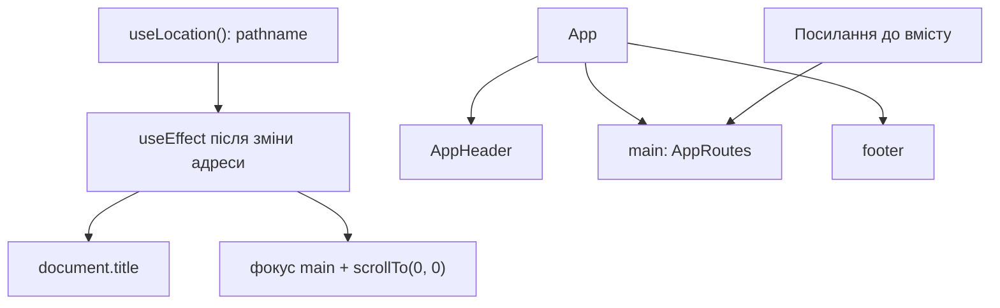

Приклад: `/notes` встановлює заголовок «Sonora — Визначення нот». Посилання пропуску шапки не змінює `hash`, який уже використовується для маршрутів.

### `src/router/index.jsx`

[Відкрити router/index.jsx](C:/Users/theva/Documents/Codex/2026-10-08/hudobn-ci-asto-vyu-vaj-softv/outputs/sonora/src/router/index.jsx)

**Задача:** вибрати компонент сторінки за шляхом. **Вхід:** поточний маршрут. **Результат:** рівно відповідна гілка маршрутизації.

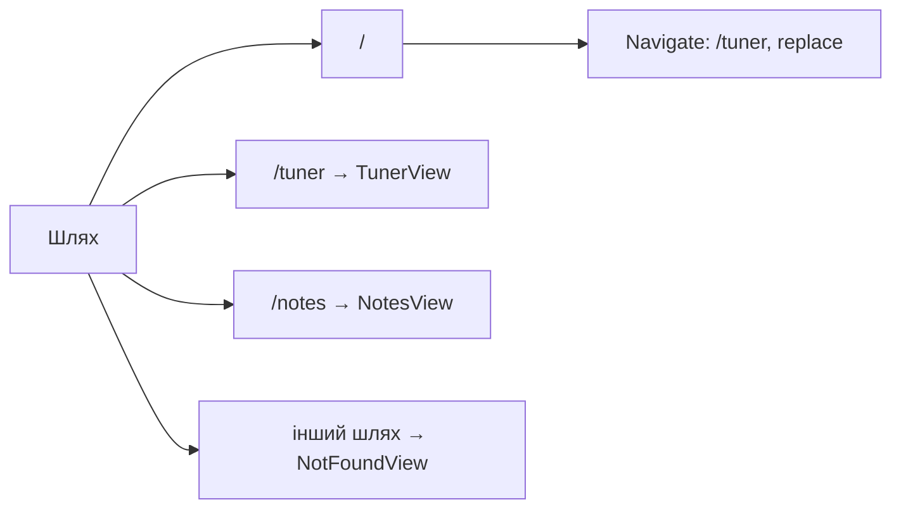

### `src/styles.css`

[Відкрити styles.css](C:/Users/theva/Documents/Codex/2026-10-08/hudobn-ci-asto-vyu-vaj-softv/outputs/sonora/src/styles.css)

**Задача:** оформлення й адаптація компонентів до ширини екрана. **Вхід:** класи HTML, стан, переданий через класи та inline-стиль стрілки, ширина вікна. **Результат:** вигляд сторінки; обчислень частоти тут немає.

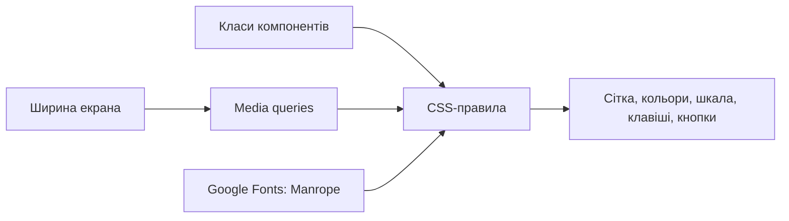

## 7. Сторінки

### `src/views/TunerView.jsx`

[Відкрити TunerView.jsx](C:/Users/theva/Documents/Codex/2026-10-08/hudobn-ci-asto-vyu-vaj-softv/outputs/sonora/src/views/TunerView.jsx)

**Задача:** сторінка тюнера, вибір гітарного/хроматичного вигляду й еталона A4. **Вхід:** кліки користувача, `pitch` із робочої області. **Результат:** компоненти сторінки й props для `TunerDisplay`.

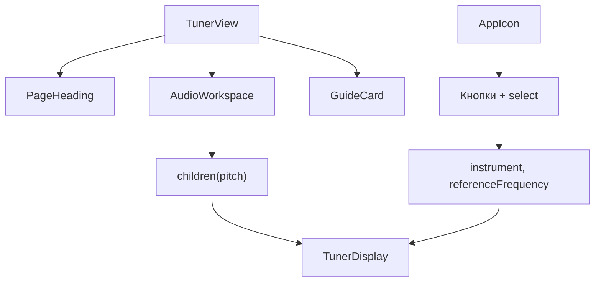

Еталон `432 / 440 / 442 Hz` змінює цільові частоти нот, **не виміряну частоту звуку**. Перемикач гітари показує орієнтири відкритих струн, а не окремий алгоритм визначення фізичної струни.

### `src/views/NotesView.jsx`

[Відкрити NotesView.jsx](C:/Users/theva/Documents/Codex/2026-10-08/hudobn-ci-asto-vyu-vaj-softv/outputs/sonora/src/views/NotesView.jsx)

**Задача:** сторінка розпізнавання однієї ноти. **Вхід:** `pitch` із `AudioWorkspace`. **Результат:** нота, октава й клавіатура через `NoteDisplay`.

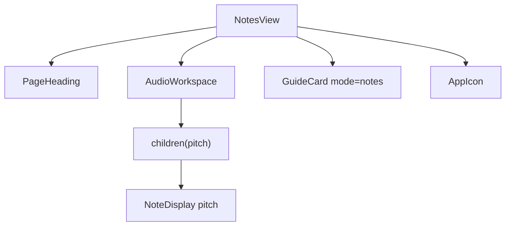

### `src/views/NotFoundView.jsx`

[Відкрити NotFoundView.jsx](C:/Users/theva/Documents/Codex/2026-10-08/hudobn-ci-asto-vyu-vaj-softv/outputs/sonora/src/views/NotFoundView.jsx)

**Задача:** повідомити про невідомий маршрут. **Вхід:** вибір маршрутизатора `*`. **Результат:** заголовок 404 і посилання до тюнера. Аудіосесії тут немає.

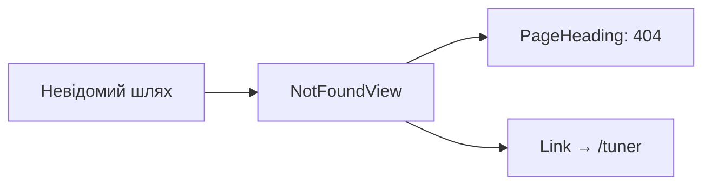

## 8. Компоненти інтерфейсу

### `src/components/AudioWorkspace.tsx`

[Відкрити AudioWorkspace.tsx](C:/Users/theva/Documents/Codex/2026-10-08/hudobn-ci-asto-vyu-vaj-softv/outputs/sonora/src/components/AudioWorkspace.tsx)

**Задача:** поєднати кнопки, джерело аудіо, аналіз частоти, монітор і вміст сторінки. **Вхід:** `title`, необов’язковий `icon`, функція `children(pitch)`. **Результат:** інтерфейс і передавання поточного `PitchReading` у вміст.

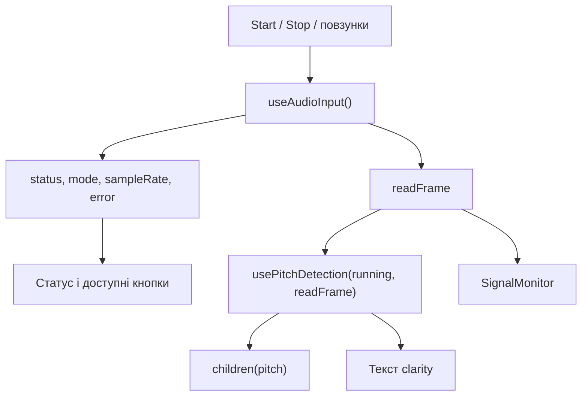

`children` тут — **функція, а не готовий елемент**. Сторінка тюнера отримує `pitch` і створює `TunerDisplay`; сторінка нот — `NoteDisplay`. Завдяки цьому керування звуком спільне, а вигляд результату різний.

### `src/components/SignalMonitor.tsx`

[Відкрити SignalMonitor.tsx](C:/Users/theva/Documents/Codex/2026-10-08/hudobn-ci-asto-vyu-vaj-softv/outputs/sonora/src/components/SignalMonitor.tsx)

**Задача:** малювати хвилю й показувати рівень. **Вхід:** `running`, `sampleRate`, функція `readFrame`. **Результат:** Canvas, RMS/dBFS, підпис стану та тривалість вікна.

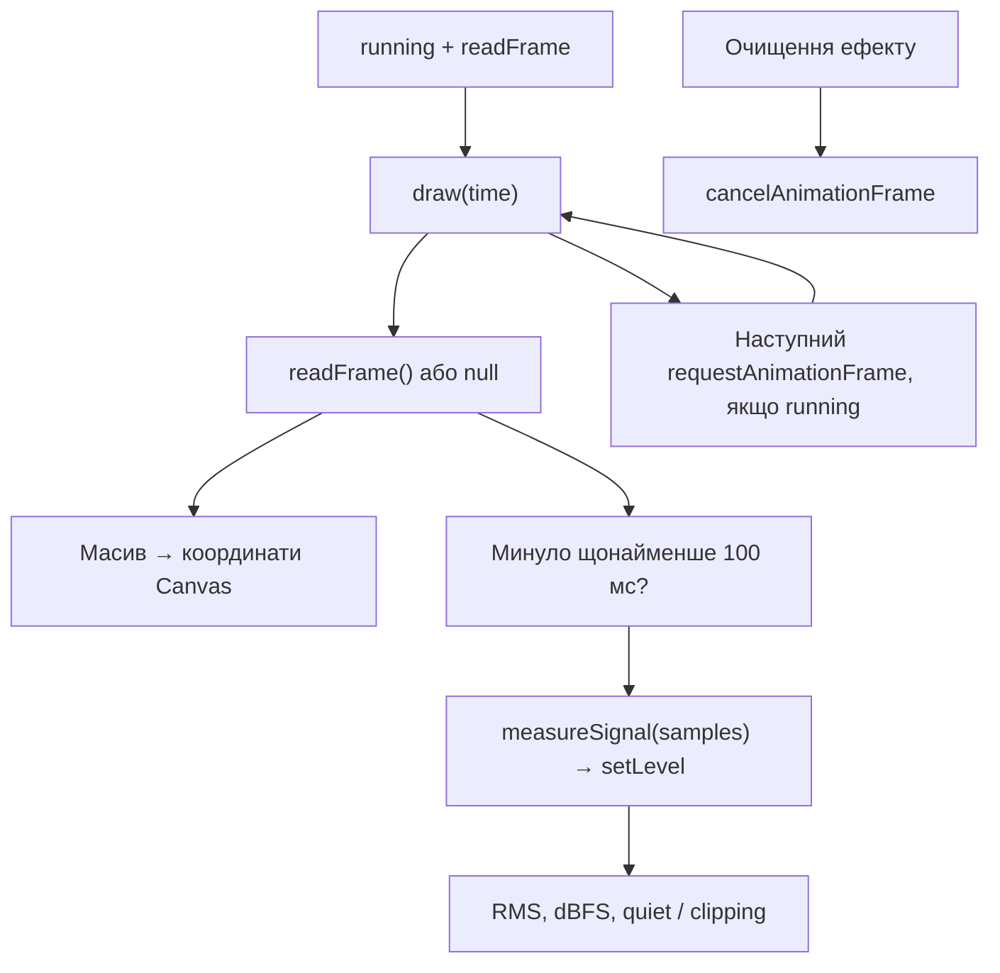

На Canvas час іде горизонтально, значення сигналу — вертикально. Підпис тривалості: `2048 / sampleRate * 1000` мс. Показаний рівень рахується за початковим масивом, без центрування; перевірка тиші в `pitch.ts` використовує іншу, центровану копію.

### `src/components/TunerDisplay.tsx`

[Відкрити TunerDisplay.tsx](C:/Users/theva/Documents/Codex/2026-10-08/hudobn-ci-asto-vyu-vaj-softv/outputs/sonora/src/components/TunerDisplay.tsx)

**Задача:** показати ноту, виміряні Hz, цільову частоту, центи та напрям налаштування. **Вхід:** `pitch`, `referenceFrequency` (типово 440), `instrument`. **Результат:** тюнер без власного доступу до мікрофона.

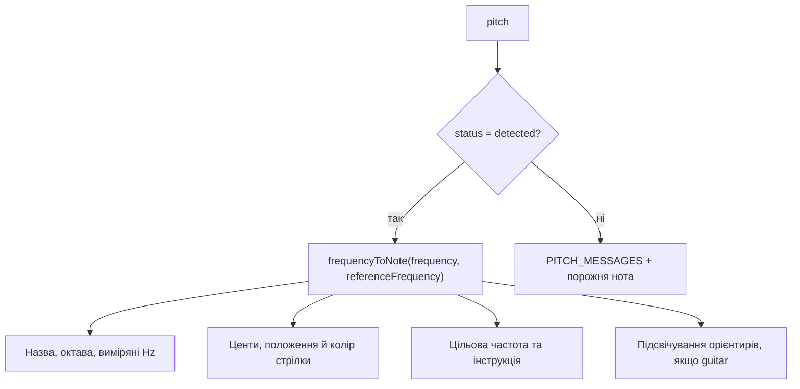

`±5` центів означає допустиме налаштування і впливає на колір/інструкцію. Поточний код **не фіксує стрілку в нулі** в цьому діапазоні й не згладжує частоту; положення відображає фактичні центи. Гітарні підписи активуються за збігом номера ноти, не за визначенням конкретної фізичної струни.

### `src/components/NoteDisplay.tsx`

[Відкрити NoteDisplay.tsx](C:/Users/theva/Documents/Codex/2026-10-08/hudobn-ci-asto-vyu-vaj-softv/outputs/sonora/src/components/NoteDisplay.tsx)

**Задача:** показати одну визначену ноту на клавіатурі. **Вхід:** `pitch`. **Результат:** назва, октава, виміряні Hz і активна біла або чорна клавіша.

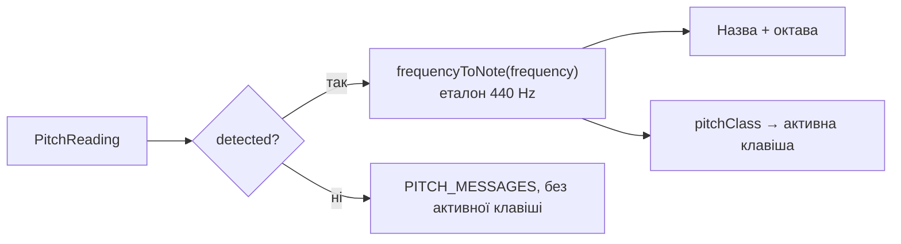

Клавіатура показує клас ноти `C…B`, а октава виводиться окремо: A3 і A4 підсвітять ту саму клавішу A, але матимуть різні підписи октави.

### `src/components/AppHeader.jsx`

[Відкрити AppHeader.jsx](C:/Users/theva/Documents/Codex/2026-10-08/hudobn-ci-asto-vyu-vaj-softv/outputs/sonora/src/components/AppHeader.jsx)

**Задача:** бренд і навігація. **Вхід:** стан маршрутизатора для `NavLink`. **Результат:** посилання на тюнер і ноти, активний пункт та іконки.

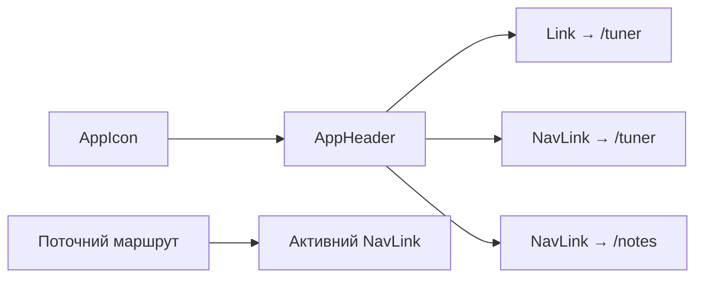

### `src/components/AppIcon.jsx`

[Відкрити AppIcon.jsx](C:/Users/theva/Documents/Codex/2026-10-08/hudobn-ci-asto-vyu-vaj-softv/outputs/sonora/src/components/AppIcon.jsx)

**Задача:** створити SVG-іконку за ім’ям. **Вхід:** `name`, `size` (типово `wave`, 20). **Результат:** декоративний `<svg>` із локально описаним шляхом.

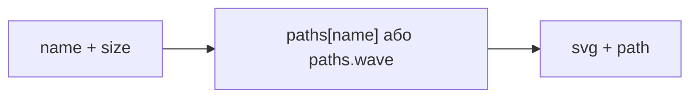

Тут немає мережевого завантаження іконок. Наприклад, `name="mic"` вибирає форму мікрофона, `size={18}` — її розмір.

### `src/components/PageHeading.jsx`

[Відкрити PageHeading.jsx](C:/Users/theva/Documents/Codex/2026-10-08/hudobn-ci-asto-vyu-vaj-softv/outputs/sonora/src/components/PageHeading.jsx)

**Задача:** однаковий заголовок на різних сторінках. **Вхід:** `eyebrow`, `title`, `description`. **Результат:** секція з коротким верхнім підписом, `h1` і описом.

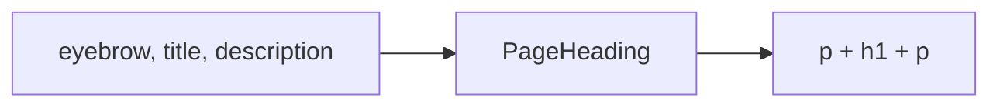

### `src/components/GuideCard.jsx`

[Відкрити GuideCard.jsx](C:/Users/theva/Documents/Codex/2026-10-08/hudobn-ci-asto-vyu-vaj-softv/outputs/sonora/src/components/GuideCard.jsx)

**Задача:** короткий сценарій ручної перевірки. **Вхід:** `mode` (типово `tuner`). **Результат:** картка: запустити демо → перевірити 440/220/880 → спробувати мікрофон.

```mermaid
flowchart LR
    Mode["mode: tuner / notes"] --> Text["Останній крок: струна / спів"]
    Text --> Card["GuideCard"]
    Icon["AppIcon"] --> Card
    Static["Демо → порівняння → мікрофон"] --> Card
```

Картка нічого не запускає сама, лише показує інструкцію.

## 9. Хуки: зв’язок аудіо та React

### `src/hooks/useAudioInput.ts`

[Відкрити useAudioInput.ts](C:/Users/theva/Documents/Codex/2026-10-08/hudobn-ci-asto-vyu-vaj-softv/outputs/sonora/src/hooks/useAudioInput.ts)

**Задача:** зберігати один `AudioInput` для робочої області й перетворювати його повідомлення на стан React. **Вхід:** виклики повернених `start/stop` і зміни демопараметрів. **Результат:** стан джерела, керування та `readFrame`.

```mermaid
flowchart TD
    Mount["Монтування"] --> Create["new AudioInput(setState)"]
    Create --> Ref["input.current"]
    Start["start(mode), stop(), readFrame()"] --> Ref
    Ref --> State["notify → setState"]
    State --> UI["Повернутий стан для AudioWorkspace"]
    Demo["frequency / amplitude у React"] --> Effect["ефект → setDemo()"]
    Effect --> Ref
    Unmount["Розмонтування"] --> Dispose["engine.dispose(), ref = null"]
```

`useRef` зберігає екземпляр між рендерами, а `useState` — дані для екрана. Початкові демопараметри: 440 Hz і 0.2. На виході `readFrame()` повертає `{ samples, sampleRate }` або `null`; `start()` із хука навмисно не очікує Promise, бо повідомлення про стан надходять через callback.

### `src/hooks/usePitchDetection.ts`

[Відкрити usePitchDetection.ts](C:/Users/theva/Documents/Codex/2026-10-08/hudobn-ci-asto-vyu-vaj-softv/outputs/sonora/src/hooks/usePitchDetection.ts)

**Задача:** регулярно запускати детектор і оновлювати `PitchReading` у React. **Вхід:** `running`, функція `readFrame`. **Результат:** поточний `pitch`; за зупинки повертається `IDLE_PITCH`.

```mermaid
flowchart TD
    Running{"running?"} -->|"ні"| Idle["IDLE_PITCH"]
    Running -->|"так"| RAF["requestAnimationFrame(update)"]
    RAF --> Time{"Минуло щонайменше 75 мс?"}
    Time -->|"так"| Read["readFrame()"]
    Read --> Frame{"Є frame?"}
    Frame -->|"ні"| Reset["setPitch(IDLE_PITCH)"]
    Frame -->|"так"| Detector["Створити/повторно використати ToneDetector"]
    Detector --> Analyze["analyze(samples, sampleRate)"]
    Analyze --> State["setPitch(result)"]
    Time -->|"ще ні"| Again["Запланувати наступний кадр"]
    State --> Again
    Reset --> Again
    Again --> RAF
```

Детектор створюється при першому доступному фрагменті та повторно, якщо змінилася довжина масиву. Очищення ефекту скасовує кадр анімації. Тут немає згладжування результатів чи накопичення запису.

## 10. Аудіомодулі

### `src/audio/AudioInput.ts`

[Відкрити AudioInput.ts](C:/Users/theva/Documents/Codex/2026-10-08/hudobn-ci-asto-vyu-vaj-softv/outputs/sonora/src/audio/AudioInput.ts)

**Задача:** створювати й прибирати аудіосесію, підключати джерело й читати фрагменти. **Вхід:** callback `notify`, `start(mode)`, `setDemo(frequency, amplitude)`, `readFrame()`, `stop()`/`dispose()`. **Результат:** повідомлення `InputState` та фрагменти звуку.

```mermaid
flowchart TD
    Start["start(mode)"] --> Stop["stop(): скасувати попереднє"]
    Stop --> Support["checkBrowserSupport(mode)"]
    Support --> Session["createSession()"]
    Session --> Resume["await context.resume()"]
    Resume --> Mode{"mode"}
    Mode -->|"microphone"| Mic["await connectMicrophone()"]
    Mode -->|"demo"| Demo["connectDemo()"]
    Mic --> Ready["ready = true"]
    Demo --> Ready
    Ready --> Watch["watchContextState()"]
    Watch --> Publish["publishContextState() → notify"]
    Error["помилка актуального запуску"] --> Report["reportError() → stop() + notify(error)"]
```

Схема показує успішну основну гілку. Після асинхронних очікувань перевіряється `generation`; при скасуванні виконання виходить раніше. Будь-яка помилка актуального `start` обробляється `catch`.

**Що зберігають головні змінні:**

| Змінна | Відповідальність | Чим вона не є |
| --- | --- | --- |
| `session` | Посилання на ресурси конкретного запуску | Не окремий етап аудіографа й не копія звуку |
| `generation` | Збережений номер запуску; порівнюється з `this.generation` | Не частота, не лічильник семплів |
| `notify` | Переданий callback повідомлення стану React | Не маршрут звуку |
| `frequency`, `amplitude` | Налаштування демогенератора | Не результати мікрофонного вимірювання |
| `session.samples` | Багаторазовий масив на 2048 вимірювань | Не вся історія запису |
| `session.ready` | Готовність підключення | Не кнопка, яка сама вмикає мікрофон |

**Підключення мікрофона:**

```mermaid
flowchart TD
    Request["requestMicrophone() → getUserMedia()"] --> Current{"generation актуальний?"}
    Current -->|"ні"| Cancel["stopStream(stream), return"]
    Current -->|"так"| Save["session.stream = stream"]
    Save --> Tracks["getLiveAudioTracks(): перевірити доріжки"]
    Tracks --> Watch["watchMicrophoneTracks(): onended"]
    Watch --> Source["createMediaStreamSource(stream)"]
    Source --> Connect["source.connect(analyser)"]
```

Мікрофон просить моно та вимкнення echo cancellation, noise suppression й auto gain. `onended` актуальної доріжки викликає `reportError`. Для генератора натомість створюються синусоїда й регулятор рівня; межі налаштувань — 100–1000 Hz та 0–0.8. `setTargetAtTime` плавно змінює параметри генератора; це **не згладжування виміряного тону**.

**Читання і звільнення ресурсів:**

```mermaid
flowchart LR
    Read["readFrame()"] --> Check{"ready і context running?"}
    Check -->|"ні"| Null["null"]
    Check -->|"так"| Copy["analyser → session.samples"]
    Copy --> Frame["{ samples, sampleRate }"]
    Stop["stop()"] --> Invalidate["generation++, session = null"]
    Invalidate --> Release["releaseSession()"]
    Release --> Cleanup["Зупинити tracks/oscillator,<br/>від’єднати вузли, закрити context"]
    Cleanup --> Idle["notify(idleState)"]
```

`dispose()` спочатку вимикає callback повідомлень і викликає `stop()`: це потрібно після розмонтування React-компонента. Коли передаємо `session` допоміжному методу, він отримує доступ до **тих самих об’єктів**, а не їхні копії.

### `src/audio/signal.ts`

[Відкрити signal.ts](C:/Users/theva/Documents/Codex/2026-10-08/hudobn-ci-asto-vyu-vaj-softv/outputs/sonora/src/audio/signal.ts)

**Задача:** загальні вимірювання рівня, розмір фрагмента та зрозумілі повідомлення про помилки. **Вхід:** `Float32Array` або об’єкт помилки. **Результат:** `{ rms, peak, dbfs }` або текст.

```mermaid
flowchart LR
    Samples["samples"] --> Squares["Сума квадратів / довжина"]
    Squares --> RMS["Корінь → rms"]
    RMS --> DB["20 × log10(rms) → dbfs"]
    Samples --> Peak["Найбільше abs(sample) → peak"]
    RMS --> Result["{ rms, peak, dbfs }"]
    DB --> Result
    Peak --> Result
    Error["error.name / error.message"] --> Message["audioErrorMessage() → текст"]
```

Приклад: `[0.1, -0.1]` дає приблизно `{ rms: 0.1, peak: 0.1, dbfs: -20 }`. Для нулів `dbfs = -Infinity`. Функція не змінює масив і сама не віднімає середнє. `FRAME_SIZE` дорівнює 2048. `audioErrorMessage` зіставляє відомі імена помилок браузера з поясненнями, інакше бере `error.message` або загальне повідомлення.

### `src/audio/pitch.ts`

[Відкрити pitch.ts](C:/Users/theva/Documents/Codex/2026-10-08/hudobn-ci-asto-vyu-vaj-softv/outputs/sonora/src/audio/pitch.ts)

**Задача:** визначити частоту одного тону й відхилити непридатні результати. **Вхід:** `samples`, `sampleRate`. **Результат:** `PitchReading`.

```mermaid
flowchart TD
    Input["samples + sampleRate"] --> Validate["Перевірити довжину, числа та sampleRate"]
    Validate --> Center["Відняти середнє → centered"]
    Center --> Level{"Рівень нижче -55 dBFS?"}
    Level -->|"так"| Quiet["quiet, frequency: null"]
    Level -->|"ні"| Pitchy["Pitchy.findPitch(centered, sampleRate)"]
    Pitchy --> Clamp["clarity → safeClarity у межах 0…1"]
    Clamp --> Valid{"Частота придатна і clarity ≥ 0.9?"}
    Valid -->|"ні"| Unclear["unclear, frequency: null"]
    Valid -->|"так"| Range{"60…1500 Hz?"}
    Range -->|"ні"| Out["out-of-range, frequency: null"]
    Range -->|"так"| Detected["detected, frequency, clarity"]
    Validate -. "непридатний вхід" .-> Unclear
```

`ToneDetector` один раз створює Pitchy та робочий масив `centered`. `analyze()` повторно використовує їх. Межі 60–1500 Hz, −55 dBFS і clarity 0.9 — **наша поточна політика прийняття**, не універсальні межі слуху чи браузера. Clarity не є ймовірністю правильної ноти. `IDLE_PITCH` — початковий стан, `PITCH_MESSAGES` — тексти для інтерфейсу.

### `src/audio/notes.ts`

[Відкрити notes.ts](C:/Users/theva/Documents/Codex/2026-10-08/hudobn-ci-asto-vyu-vaj-softv/outputs/sonora/src/audio/notes.ts)

**Задача:** перевести частоту в музичне позначення. **Вхід:** `frequency`, необов’язковий `referenceA4` (типово 440). **Результат:** об’єкт ноти або `null` для непридатного входу.

```mermaid
flowchart TD
    Input["frequency + referenceA4"] --> Validate["Скінченні додатні числа?"]
    Validate --> Midi["69 + 12 × log2(frequency / referenceA4)<br/>округлити → midi"]
    Midi --> Names["pitchClass + octave → назви й label"]
    Midi --> Target["referenceA4 × 2^((midi - 69) / 12)"]
    Target --> Cents["1200 × log2(frequency / targetFrequency)"]
    Cents --> Direction["±5 → in-tune<br/>нижче → flat, вище → sharp"]
    Names --> Result["Об’єкт ноти"]
    Target --> Result
    Direction --> Result
```

Приклад: `frequencyToNote(440)` повертає A4, MIDI 69, ціль 440 Hz, близько 0 центів, `in-tune`. Виміряну частоту функція не переписує цільовою. MIDI тут — **числовий номер ноти**, ми не отримуємо MIDI-повідомлення з інструмента. `pitchClass` — позиція серед 12 нот октави (`C = 0`, `A = 9`); `B` означає «сі».

## 11. Імпорти: хто використовує кого

Тут стрілка означає **імпорт**, а не потік звуку. У схемах показані внутрішні залежності файлів; React, Router і Pitchy — зовнішні бібліотеки. Типові імпорти `import type` не створюють окремого виконання в браузері.

### Центральні аудіозалежності

```mermaid
flowchart LR
    Workspace["AudioWorkspace.tsx"] --> AudioHook["useAudioInput.ts"]
    Workspace --> PitchHook["usePitchDetection.ts"]
    Workspace --> Monitor["SignalMonitor.tsx"]
    AudioHook --> Input["AudioInput.ts"]
    Input --> Signal["signal.ts"]
    Monitor --> Signal
    PitchHook --> Pitch["pitch.ts"]
    Pitch --> Signal
    Pitch --> Pitchy["pitchy: зовнішня бібліотека"]
    Tuner["TunerDisplay.tsx"] --> Notes["notes.ts"]
    NoteDisplay["NoteDisplay.tsx"] --> Notes
    Tuner --> Pitch
    NoteDisplay --> Pitch
```

### Запуск і сторінки

```mermaid
flowchart LR
    Main["main.jsx"] --> App["App.jsx"]
    Main --> CSS["styles.css"]
    App --> Header["AppHeader.jsx"]
    App --> Routes["router/index.jsx"]
    Routes --> Tuner["TunerView.jsx"]
    Routes --> Notes["NotesView.jsx"]
    Routes --> Missing["NotFoundView.jsx"]
    Tuner --> Workspace["AudioWorkspace.tsx"]
    Notes --> Workspace
    Tuner --> TD["TunerDisplay.tsx"]
    Notes --> ND["NoteDisplay.tsx"]
```

Повторювані декоративні імпорти `PageHeading`, `GuideCard` і `AppIcon` наведені в розділах самих файлів, щоб не перетворювати цю схему на клубок.

## 12. Тести: що саме вони перевіряють

```mermaid
flowchart LR
    AudioTest["audio-input.test.ts"] --> Mock["Підставні браузерні об’єкти"]
    Mock --> Input["AudioInput.ts: життєвий цикл"]
    PitchTest["pitch.test.ts"] --> Synthetic["Чисельно створені сигнали"]
    Synthetic --> Real["ToneDetector + справжня Pitchy"]
    PitchTest --> Notes["frequencyToNote()"]
    SignalTest["signal.test.ts"] --> Signal["measureSignal()"]
```

| Файл | Перевірки | Межа перевірки |
| --- | --- | --- |
| [tests/audio-input.test.ts](C:/Users/theva/Documents/Codex/2026-10-08/hudobn-ci-asto-vyu-vaj-softv/outputs/sonora/tests/audio-input.test.ts) | Зупинка й очищення, запізнілий дозвіл/відмова, dispose, від’єднання, пауза й відновлення | Моки, а не фізичний мікрофон або реальний браузер |
| [tests/pitch.test.ts](C:/Users/theva/Documents/Codex/2026-10-08/hudobn-ci-asto-vyu-vaj-softv/outputs/sonora/tests/pitch.test.ts) | Синусоїди при 44.1/48/96 kHz, гармоніки, тиша, шум, DC offset, межі, невалідний вхід, ноти, центи й еталон | Справжня Pitchy; штучні сигнали, не всі реальні інструменти |
| [tests/signal.test.ts](C:/Users/theva/Documents/Codex/2026-10-08/hudobn-ci-asto-vyu-vaj-softv/outputs/sonora/tests/signal.test.ts) | RMS/dBFS тиші й синусоїди, зміна рівня, знаки й значення понад шкалу | Числові розрахунки, не акустична гучність у кімнаті |

Математичний тест може підтвердити результат для заданих чисел. Він не підтверджує дозвіл мікрофона, затримку чи точність на конкретному телефоні. Ці сценарії потребують окремої перевірки у браузері.

## 13. Конфігурація, документація й ресурси

### Як запускається й збирається проєкт

```mermaid
flowchart LR
    Package["package.json: scripts"] --> Dev["dev → Vite"]
    Package --> Build["build → tsc --noEmit → vite build"]
    Package --> Test["test → node --test"]
    TS["tsconfig.json"] --> Build
    Vite["vite.config.js"] --> Dev
    Vite --> Build
    HTML["index.html + src + public"] --> Build
    Build --> Dist["dist: згенеровані файли"]
    Dist --> Preview["preview: показати збірку локально"]
```

| Файл | Навіщо він |
| --- | --- |
| [index.html](C:/Users/theva/Documents/Codex/2026-10-08/hudobn-ci-asto-vyu-vaj-softv/outputs/sonora/index.html) | Стартовий HTML: `#app`, підключення `/src/main.jsx`, метадані, favicon |
| [package.json](C:/Users/theva/Documents/Codex/2026-10-08/hudobn-ci-asto-vyu-vaj-softv/outputs/sonora/package.json) | Команди запуску/перевірки/збірки та список залежностей |
| [package-lock.json](C:/Users/theva/Documents/Codex/2026-10-08/hudobn-ci-asto-vyu-vaj-softv/outputs/sonora/package-lock.json) | Зафіксоване дерево версій установлених пакетів |
| [tsconfig.json](C:/Users/theva/Documents/Codex/2026-10-08/hudobn-ci-asto-vyu-vaj-softv/outputs/sonora/tsconfig.json) | Правила TypeScript; перевірка `src`, strict, DOM, JSX; `checkJs` вимкнено, `.js/.jsx` дозволені |
| [vite.config.js](C:/Users/theva/Documents/Codex/2026-10-08/hudobn-ci-asto-vyu-vaj-softv/outputs/sonora/vite.config.js) | React-плагін, відносна база збірки, збереження символьних шляхів |
| [.gitignore](C:/Users/theva/Documents/Codex/2026-10-08/hudobn-ci-asto-vyu-vaj-softv/outputs/sonora/.gitignore) | Виключає `node_modules`, `dist`, логи й `.DS_Store` зі звичайного відстеження Git |
| [.openai/hosting.json](C:/Users/theva/Documents/Codex/2026-10-08/hudobn-ci-asto-vyu-vaj-softv/outputs/sonora/.openai/hosting.json) | Налаштування Sites: ідентифікатор проєкту й папка `dist`; сам файл не доводить успішну публікацію |
| [public/favicon.svg](C:/Users/theva/Documents/Codex/2026-10-08/hudobn-ci-asto-vyu-vaj-softv/outputs/sonora/public/favicon.svg) | Іконка вкладки; статичний ресурс, без аудіологіки |

### Навчальні файли

| Файл | Коли відкривати |
| --- | --- |
| [README.md](C:/Users/theva/Documents/Codex/2026-10-08/hudobn-ci-asto-vyu-vaj-softv/outputs/sonora/README.md) | Як запустити застосунок і що в ньому вже реалізовано |
| [docs/PROJECT-MAP.md](C:/Users/theva/Documents/Codex/2026-10-08/hudobn-ci-asto-vyu-vaj-softv/outputs/sonora/docs/PROJECT-MAP.md) | Ця карта: маршрут звуку, даних, викликів і відповідальність кожного файлу |
| [docs/ROADMAP.md](C:/Users/theva/Documents/Codex/2026-10-08/hudobn-ci-asto-vyu-vaj-softv/outputs/sonora/docs/ROADMAP.md) | Послідовність практичних етапів і критерії готовності |
| [docs/LAB-01.md](C:/Users/theva/Documents/Codex/2026-10-08/hudobn-ci-asto-vyu-vaj-softv/outputs/sonora/docs/LAB-01.md) | Перші експерименти зі звуком і відображенням сигналу |
| [docs/LAB-02.md](C:/Users/theva/Documents/Codex/2026-10-08/hudobn-ci-asto-vyu-vaj-softv/outputs/sonora/docs/LAB-02.md) | Визначення тону, ноти, центового відхилення та ручні перевірки |
| [docs/PITCH-LINE-BY-LINE.md](C:/Users/theva/Documents/Codex/2026-10-08/hudobn-ci-asto-vyu-vaj-softv/outputs/sonora/docs/PITCH-LINE-BY-LINE.md) | Детальний навчальний знімок `pitch.ts`; навчальні коментарі й оформлення можуть відрізнятися від поточного файлу |

`node_modules` — завантажені бібліотеки, `dist` — результат збірки. Їхні внутрішні файли не потрібно вчити як власний код. Після зміни `src` стара `dist` не оновиться сама без збірки.

## 14. Короткий словник для цієї карти

| Слово | Значення тут |
| --- | --- |
| Sample / вимірювання | Одне число сигналу в один момент часу |
| Sample rate | Скільки вимірювань відповідає одній секунді |
| Frame / фрагмент | Вікно останніх вимірювань; у нас 2048 чисел |
| Frequency / Hz | Кількість повних повторень сигналу за секунду |
| RMS | Міра величини сигналу за фрагментом через середній квадрат і корінь |
| dBFS | Рівень цифрового сигналу відносно амплітудної шкали 1; не dB SPL у кімнаті |
| DC offset | Постійне зміщення середнього рівня сигналу; його віднімання не є видаленням сторонніх звуків |
| Clarity | Оцінка чіткості періодичності Pitchy, не ймовірність правильності |
| Cent / цент | 1/100 півтону; використовується для відхилення від цільової ноти |
| AudioContext | Середовище аудіообробки, яке створює вузли й керує їхнім часом |
| AudioNode / вузол | Об’єкт аудіообробки, який можна з’єднувати з іншими |
| MediaStream / потік | Набір медіадоріжок запису, отриманий від браузера |
| Track / доріжка | Окрема медіадоріжка всередині потоку; не тотожна лівому/правому каналу |
| Session / сесія | Наш об’єкт із ресурсами одного запуску |
| Generation | Наш номер актуальності запуску для захисту після `await` |
| Hook / хук | React-функція для стану й поведінки компонента |
| Callback | Функція, передана іншому коду для подальшого виклику |
| Mount / unmount | Поява / прибирання компонента в дереві React |
| requestAnimationFrame | Запланований браузером виклик перед наступним кадром інтерфейсу |
| Import | Залежність файлу від іншого модуля; не маршрут звуку |
